<div align="center">

  <br>

  <a href="https://github.com/chengmarc/minecraft-citygen/releases/latest/download/MC.CityGen-setup.exe"></a>
  <a href="https://apps.microsoft.com/detail/9NPSMX3TB1T7"></a>
  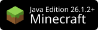

  <h1>MC CityGen - Procedural City Generator</h1>
  
  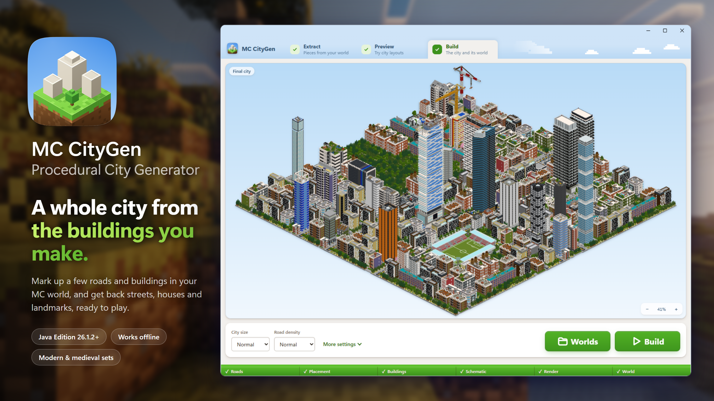
  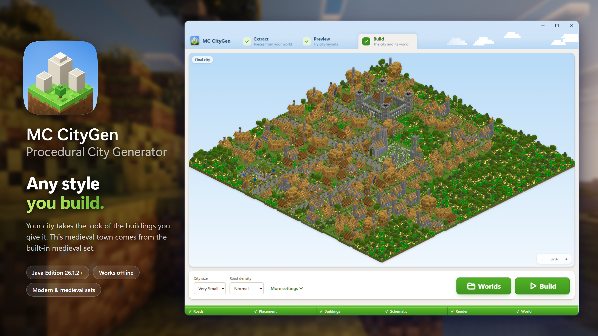

</div>

## Generated Cities

<table>
  <tr><th width="50%">Modern City</th><th width="50%">Medieval City</th></tr>
  <tr>
    <td valign="bottom" align="center">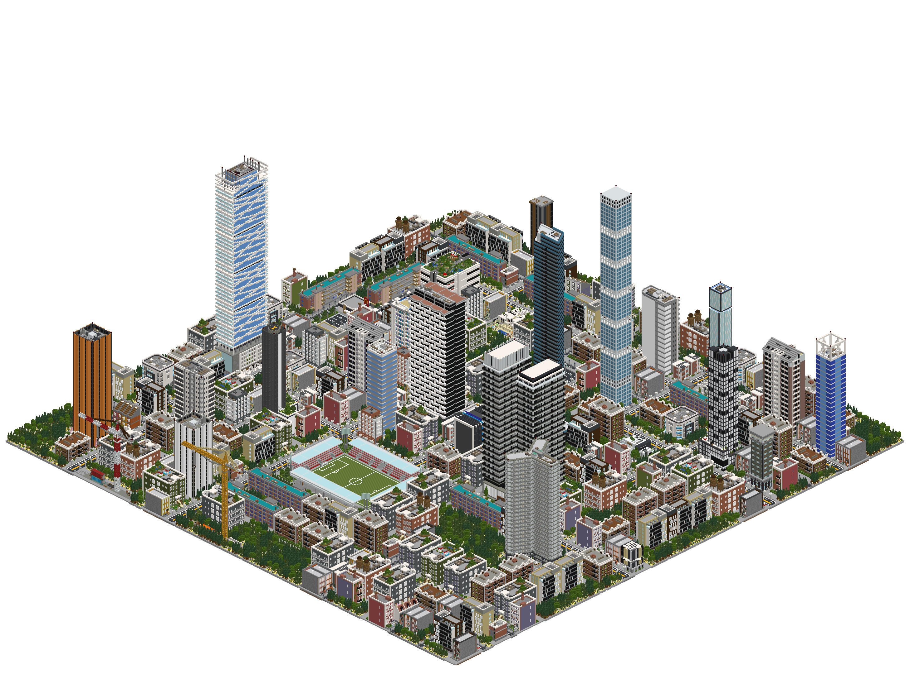</td>
    <td valign="bottom" align="center">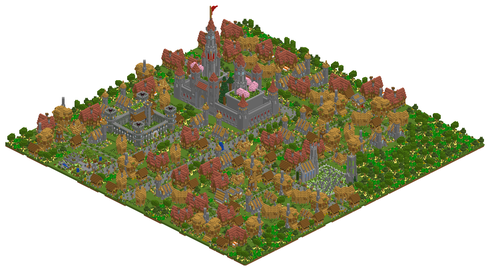</td>
  </tr>
  <tr>
    <td>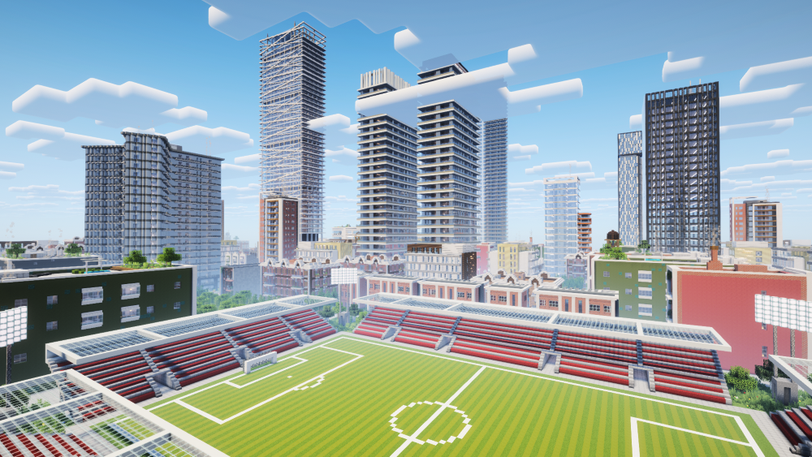</td>
    <td>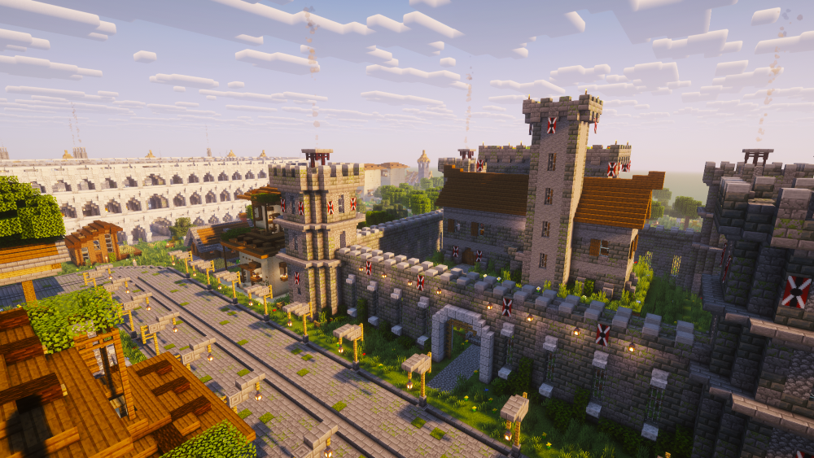</td>
  </tr>
  <tr>
    <td>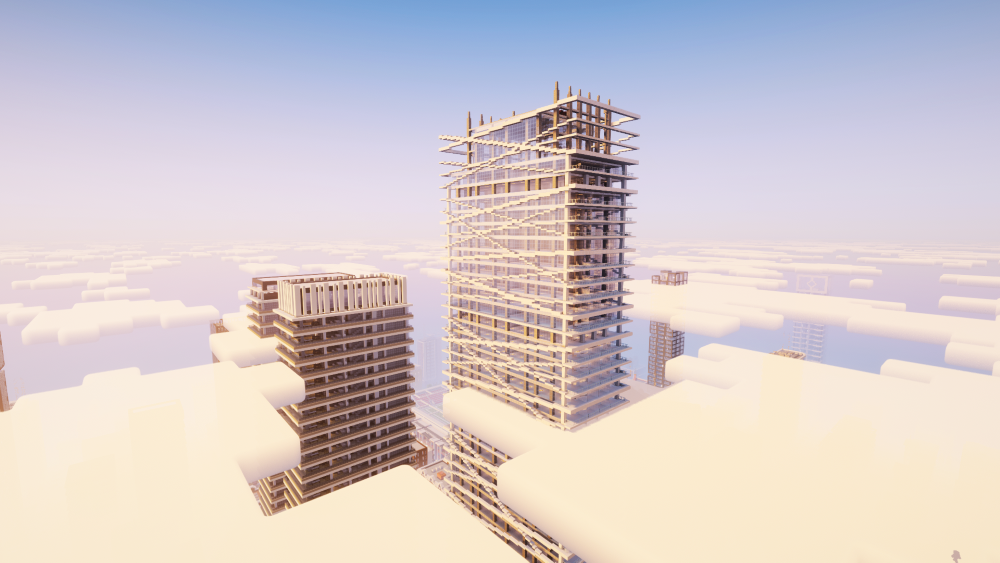</td>
    <td>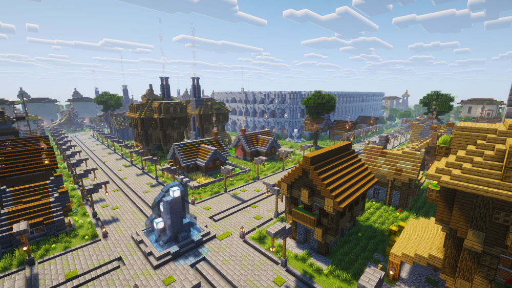</td>
  </tr>
</table>

# Built-in Assets

## Modern Assets

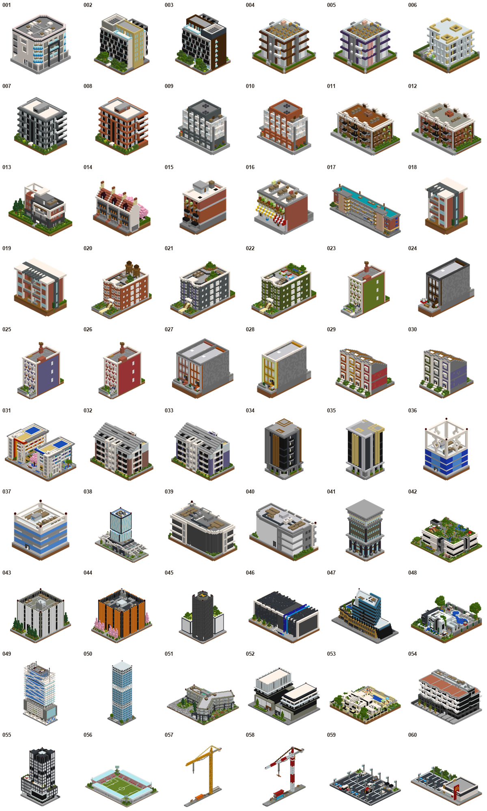

## Medieval Assets

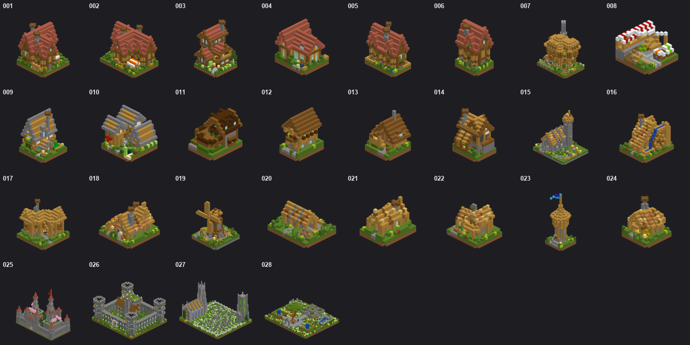

# Tutorial - Marking Your Own Assets

### Your buildings must face south

**MC CityGen** builds cities from structures you mark up inside your own MC world,
using a handful of marker blocks.

For buildings, place: 
- a **Gold block** and a **Diamond block** at two opposite corners of each region you want captured.
- an **Emerald block** horizontally adjacent to the bottom gold block to mark the authored ground level. 

## One-piece building & three-piece building
- One gold/diamond pair creates a one-piece building.
- Three vertically aligned pairs with the same footprint create a stackable building with bottom, middle, and top pieces. 
- You can tune any three-piece building with a sign directive above its emerald: `stack: 3-7` — how many middle sections it may grow (min–max)

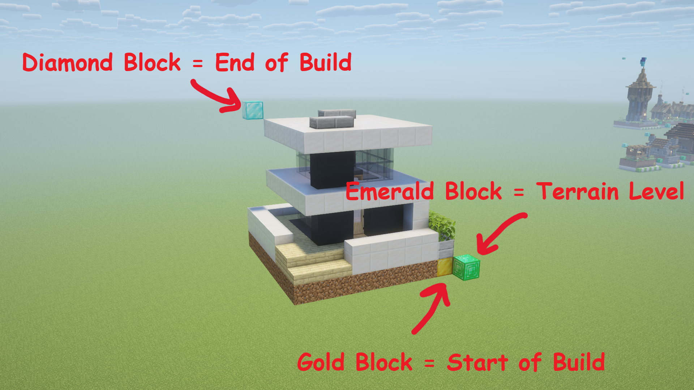

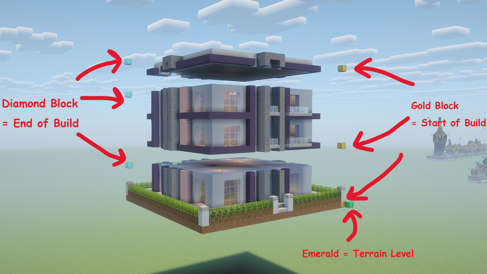

The exact rules for roads and buildings are in the
[in-world asset conventions](src/README.md#in-world-asset-conventions).

# Technical Details

```bash
python -m pip install -e .
python -m pytest -q
pythonw src/application.pyw
```

The source is one package, `src/citygen/`; its guide is [src/README.md](src/README.md). Releases follow the
[release guide](docs/RELEASING.md).